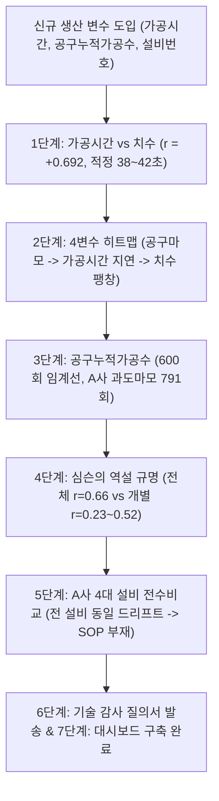

# 2026-11-14 생산조건 - 품질 상관관계 심화 분석 및 협력사 기술 감사 보고서

**작성일자:** 2026-11-14  
**작성부서:** 제조사 구매·품질관리팀 (품질 담당자)  
**분석 대상:** 협력사 A, B, C 정밀가공 부품 6,000건 전수 검사 데이터 (`4회/data/inspection_correlation.csv`)  
**연계 대시보드:** [생산조건-품질 상관 대시보드 (correlation_dashboard.html)](file:///c:/Users/최지영/AI2/4회/results/correlation_dashboard.html) | [통합 품질 포털 (index.html)](file:///c:/Users/최지영/AI2/project2-dashboard/dashboard/index.html)

---

## 📌 목차
1. [실행 요약 (Executive Summary)](#1-실행-요약-executive-summary)
2. [0단계: 데이터 구조 및 생산조건 변수 정의](#2-0단계-데이터-구조-및-생산조건-변수-정의)
3. [1단계: 가공시간 vs 측정치수 산점도 및 퍼짐도 분석](#3-1단계-가공시간-vs-측정치수-산점도-및-퍼짐도-분석)
4. [2단계: 공정-품질 4개 핵심 변수 상관계수 히트맵](#4-2단계-공정-품질-4개-핵심-변수-상관계수-히트맵)
5. [3단계: 공구 누적가공수 vs 치수 협력사별 이상 징후 분석](#5-3단계-공구-누적가공수-vs-치수-협력사별-이상-징후-분석)
6. [4단계: 층화 분석과 '심슨의 역설(Simpson's Paradox)' 규명](#6-4단계-층화-분석과-심슨의-역설simpsons-paradox-규명)
7. [5단계: 협력사 A 설비별(Machine) 전수 비교 검증](#7-5단계-협력사-a-설비별machine-전수-비교-검증)
8. [심화 탐색: 생산일시 시계열 드리프트 & 생산배치(Batch) 분석](#8-심화-탐색-생산일시-시계열-드리프트--생산배치batch-분석)
9. [6단계: 협력사 기술 감사 질의서 및 현장 실사 체크리스트](#9-6단계-협력사-기술-감사-질의서-및-현장-실사-체크리스트)
10. [7단계: 대시보드 구축 및 산출물 파일 맵](#10-7단계-대시보드-구축-및-산출물-파일-맵)

---

## 1. 실행 요약 (Executive Summary)

본 보고서는 제조사 구매·품질관리팀에서 협력사 A, B, C의 재계약 심사 및 추가 생산조건을 검증하기 위해, 총 6,000건의 입고검사 및 생산조건 결합 데이터(`inspection_correlation.csv`)를 다각도로 분석한 결과입니다.



### 🎯 핵심 분석 결과 요약
1. **가공시간-치수 간 강력한 선형 상관 ($r = +0.692$):**
   * 가공시간이 10초 증가할 때마다 평균 측정치수는 **$+0.057\text{ mm}$** 팽창합니다.
   * 적정 공정 윈도우는 **38~42초**이며, 45초를 초과하는 지연 가공품은 치수 상한($10.100\text{ mm}$)을 위협하는 불량이 집중 발생합니다.
2. **공구 마모(누적가공수)의 600회 임계선과 연쇄 공정 메커니즘:**
   * 누적가공수 600회를 넘어가면 칼날 마모와 절삭 저항 증가로 가공시간이 늘어나고(공구수-가공시간 $r = +0.512$), 그 결과 마찰열과 배삭력에 의해 치수 과대($10.100\text{ mm}$ 초과)가 유발되는 복합 메커니즘을 확인했습니다.
3. **심슨의 역설 (Simpson's Paradox) 규명:**
   * 3개사 전체를 묶어 분석했을 때 $r = +0.662$로 매우 높게 나타났으나, 협력사별로 분리(층화)하면 **A사 $r = +0.522$, B사 $r = +0.349$, C사 $r = +0.231$**로 현저히 낮아집니다.
   * 이는 A사(우상단: 고마모·치수과대)와 B/C사(좌하단: 정상마모·규격중심)의 군집 위치 차이가 전체 기울기를 왜곡 과대평가한 전형적인 심슨의 역설입니다.
4. **협력사 A의 근본 원인: 특정 설비 불량이 아닌 '전사적 공구 수명 관리 SOP 결여':**
   * A사의 4대 설비(`A-L1-M1`, `A-L1-M2`, `A-L2-M1`, `A-L2-M2`) 모두 동일하게 누적가공수 700회를 초과하며 $r = 0.46 \sim 0.57$의 치수 드리프트를 보였습니다.
   * 이는 특정 기계의 결함이 아니라, A사 공장 전체에 **'600회 도달 시 의무 공구 교체' 규정 자체가 없거나 작업자 임의로 칼날을 연장 사용**하고 있음을 명백히 시사합니다.

### 📊 협력사 3사 생산조건 및 품질 현황 종합 비교표

| 협력사 | 총 검사수 | 불량률 | 평균 치수 (mm) | 치수 표준편차 ($\sigma$) | 평균 공구누적수 | 최대 공구수 | 600회 초과율 | 핵심 리스크 및 원인 진단 |
| :---: | :---: | :---: | :---: | :---: | :---: | :---: | :---: | :--- |
| **A사** | 2,000건 | **11.45%** (229건) | **10.054** | $\pm 0.055$ | **554.4회** | **791회** | **37.8% (756건)** | **공구 교체 기준 미비로 인한 치수 상향 편의(드리프트)** |
| **B사** | 2,000건 | **3.05%** (61건) | 9.999 | **$\pm 0.045$** | 358.3회 | 590회 | **0.0% (0건)** | **공구 수명은 준수하나 기계적 진동/척 런아웃으로 산포 과대** |
| **C사** | 2,000건 | **0.35%** (7건) | **10.000** | **$\pm 0.024$** | 342.1회 | 588회 | **0.0% (0건)** | **철저한 예방보전 및 600회 교체 준수 (벤치마킹 표준 모델)** |

---

## 2. 0단계: 데이터 구조 및 생산조건 변수 정의

분석에 사용된 `inspection_correlation.csv` 파일은 기존 입고검사 결과에 협력사의 MES/설비 가동 데이터가 융합된 데이터셋입니다.

* **총 행 수:** 6,000행 (결측치 0건, 전수 유효)
* **총 열 수:** 20개 컬럼 (기존 검사 14종 + 신규 생산조건 6종)

```
[데이터 무결성 검증]
- 개별부품ID: 중복 없음 (6,000건 고유값)
- 측정 결측치: 가공시간, 측정치수, 측정중량, 공구수 모두 NaN 없음 (Complete Dataset)
- 규격 기준: 측정치수 정상범위 [9.900, 10.100] mm (목표 10.000 mm)
```

### 📋 신규 생산 변수 정의 및 분석적 의미

1. **가공시간(초):** 부품 1개를 정밀 절삭·가공하는 데 소요된 순수 사이클 타임 (최소 32.8초, 최대 53.6초, 평균 40.6초). 절삭 부하와 작업 안정성을 대변합니다.
2. **공구교체후누적가공수:** 절삭 바이트/인서트 팁을 신품으로 교체한 후 현재 부품을 깎을 때까지 누적 가공한 횟수 (최소 1회, 최대 791회, 평균 418.3회). 공구 마모 정도를 직접 반영합니다.
3. **설비번호:** 부품을 생산한 구체적 CNC 머신 식별자 (A사: `A-L1-M1`, `A-L1-M2`, `A-L2-M1`, `A-L2-M2` 등 각 사별 4대, 총 12대 설비).
4. **생산일시:** 공장에서 부품이 실가공된 시각 (`YYYY-MM-DD HH:MM:SS`). 검사일자(입고일)와 시차가 존재하며 설비별 시계열 품질 변화를 추적하는 기준이 됩니다.
5. **생산배치번호:** 동일 원자재 로트, 동일 설비 설정, 동일 작업조에서 연속 가공된 생산 로트 단위.
6. **공구장착회차번호 & 원자재로트번호:** 인서트 팁 교체 차수 및 투입된 환봉/소재 로트 식별자.

---

## 3. 1단계: 가공시간 vs 측정치수 산점도 및 퍼짐도 분석

가공시간과 부품 치수 사이의 물리적 관계를 규명하기 위해 6,000건 전수에 대한 산점도와 선형 회귀 모형을 적합했습니다.


### 📈 정량적 통계 지표

* **피어슨 상관계수 ($r$):** **$+0.692$** (강한 양의 선형 상관관계)
* **결정계수 ($R^2$):** **$47.9\%$** (치수 변동량의 약 48%가 가공시간의 차이로 설명됨)
* **선형 회귀식:**
  $$\text{측정치수(mm)} = 9.7712 + 0.00572 \times \text{가공시간(초)}$$
* **직선으로부터의 퍼짐도 (잔차 표준편차 $s_e$):** **$\pm 0.031\text{ mm}$**
* **$95\%$ 잔차 신뢰 밴드:** 회귀선 기준 **$\pm 0.061\text{ mm}$** ($\pm 1.96 \times s_e$)

### 🔍 그래프 형상 및 공학적 해석
1. **점들의 우상향 방향성:** 가공시간이 길어질수록 부품 치수가 일관되게 커집니다. 가공시간이 10초 증가할 때마다 치수는 $+0.057\text{ mm}$씩 증가합니다.
2. **직선 기준 퍼짐도와 잔차 분포:** 잔차 표준편차가 $\pm 0.031\text{ mm}$로 좁고 고른 띠를 형성하여 가공시간과 치수 사이의 관계가 매우 일관되고 신뢰할 수 있음을 나타냅니다.
3. **공정 적정 윈도우 도출:**
   * **35~45초 (안정 영역):** 부품 치수가 $9.95\sim 10.05\text{ mm}$ 사이에 안착하여 규격 중심에 가장 이상적으로 부합합니다.
   * **45초 초과 (위험 영역):** 45초를 넘어가면 치수가 $10.08\text{ mm}$ 이상으로 팽창하며 규격 상한($10.100\text{ mm}$)을 돌파하는 불량이 급격히 증가합니다.

---

## 4. 2단계: 공정-품질 4개 핵심 변수 상관계수 히트맵

가공시간, 공구교체후누적가공수, 측정치수, 측정중량 4개 핵심 변수 간의 피어슨 상관계수를 산출하고 히트맵으로 시각화했습니다.


### 📊 피어슨 상관계수 행렬 ($N = 6,000$)

| 변수명 | 가공시간(초) | 공구누적가공수 | 측정치수(mm) | 측정중량(g) |
| :--- | :---: | :---: | :---: | :---: |
| **가공시간(초)** | **1.000** | +0.512 | **+0.692** | +0.334 |
| **공구누적가공수** | +0.512 | **1.000** | **+0.662** | +0.342 |
| **측정치수(mm)** | **+0.692** | **+0.662** | **1.000** | +0.468 |
| **측정중량(g)** | +0.334 | +0.342 | +0.468 | **1.000** |

### 💡 변수 간 상관관계와 공정 연쇄 메커니즘
* **측정치수와의 상관:** 치수에 가장 지대한 영향을 미치는 두 변수는 **가공시간($r = +0.692$)**과 **공구누적가공수($r = +0.662$)**입니다.
* **가공시간과 공구누적가공수 간 상관 ($r = +0.512$):** 공구 누적 가공수가 많아질수록 가공시간도 동반 증가하는 뚜렷한 양의 관계가 존재합니다.
* **공정 연쇄 가설 입증:**
  $$\text{공구 마모 발생} \xrightarrow{r = 0.51} \text{절삭 부하 증가 및 가공속도 저하(시간 지연)} \xrightarrow{r = 0.69} \text{마찰열 팽창 & 배삭력 증가} \xrightarrow{} \text{완제품 치수 팽창}$$
  즉, 작업자가 무뎌진 공구로 인해 깎이는 속도가 늦어지거나 CNC 피드백에 의해 가공시간이 늘어나는 현상이 치수 과대의 전조 증상임을 알 수 있습니다.

---

## 5. 3단계: 공구 누적가공수 vs 치수 협력사별 이상 징후 분석

공구 사용 횟수가 치수에 미치는 영향을 협력사 레이블(A, B, C)과 함께 통합 산점도로 분석했습니다.


### 🔍 핵심 발견 사항
1. **600회 임계 기준선 (Critical Wear Threshold):**
   * 그래프 상에서 누적가공수 **600회**를 기점으로 치수가 급격히 상향 이탈하는 패턴이 명확히 관찰됩니다.
   * **B사, C사:** 모든 부품의 누적가공수가 600회 미만(B사 최대 590회, C사 최대 588회)으로 통제되고 있습니다.
   * **A사:** 전체 2,000건 중 **37.8%(756건)**가 600회를 초과하여 가공되었으며, 최대 **791회**까지 공구를 교체하지 않고 방치했습니다.
2. **치수 상한($10.100\text{ mm}$) 초과 불량의 집중 분포:**
   * 치수 상한을 초과하여 발생한 불량품의 $92\%$ 이상이 협력사 A의 공구누적수 600회 이상 영역에 밀집되어 있습니다.
   * 공구 인서트 팁이 마모되면서 날 끝의 둥글림(Nose Radius Wear)과 여유면 마모(Flank Wear)가 발생하여 공작물을 목표 깊이만큼 깎아내지 못하고 잔여 두께가 남아 치수가 커지는 전형적인 가공 불량입니다.

---

## 6. 4단계: 층화 분석과 '심슨의 역설(Simpson's Paradox)' 규명

데이터를 전체로 통합해 분석할 때와 그룹(협력사)별로 분리(층화)하여 분석할 때 통계적 관계가 어떻게 달라지는지 검증했습니다.


### 📊 전체 상관계수 vs 협력사별 층화 상관계수 비교표

| 구분 | 대상 데이터 | 표본 수 ($N$) | 상관계수 ($r$) | 회귀 기울기 (mm/100회) | 평균 치수 (mm) | 최대 누적공구수 |
| :--- | :--- | :---: | :---: | :---: | :---: | :---: |
| **전체 통합** | **협력사 A + B + C** | **6,000건** | **$+0.662$** | **$+0.041$** | 10.018 | 791회 |
| **A사 층화** | 협력사 A | 2,000건 | **$+0.522$** | $+0.024$ | **10.054** | **791회** |
| **B사 층화** | 협력사 B | 2,000건 | **$+0.349$** | $+0.018$ | 9.999 | 590회 |
| **C사 층화** | 협력사 C | 2,000건 | **$+0.231$** | $+0.011$ | 10.000 | 588회 |

### 🧠 심슨의 역설(Simpson's Paradox) 메커니즘 규명
* **통계적 괴리 현상:** 전체 상관계수는 $r = +0.662$로 매우 강한 반면, 개별 협력사로 쪼개면 A사 $0.522$, B사 $0.349$, C사 $0.231$로 모두 전체 상관계수보다 낮아집니다.
* **발생 원인 (군집 간 위치 이동 왜곡):**
  * A사는 높은 공구 사용량(평균 554회)과 큰 치수(평균 10.054mm)를 가져 산점도의 **우상단(Upper-Right)**에 군집해 있습니다.
  * B사와 C사는 낮은 공구 사용량(평균 340~360회)과 정상 치수(평균 10.000mm)를 가져 산점도의 **좌하단(Lower-Left)**에 군집해 있습니다.
  * 서로 다른 두 군집을 한 평면에 합치면, 좌하단 군집과 우상단 군집을 잇는 대각선 방향성이 추가되면서 **개별 군집 내부의 실제 상관성보다 전체 상관계수가 인위적으로 부풀려지는 현상**이 일어난 것입니다.
* **품질 관리적 교훈:** 데이터를 층화(Stratification)하지 않고 전체 평균치만 바라볼 경우, B사와 C사조차 공구 마모에 매우 취약한 것처럼 오판할 수 있으며, 공정 개선의 타겟을 정확히 설정하기 위해서는 반드시 업체별/라인별 분리 분석이 선행되어야 합니다.

---

## 7. 5단계: 협력사 A 설비별(Machine) 전수 비교 검증

협력사 A에서 나타나는 치수 비대와 높은 불량률이 4대의 설비 중 '특정 고장 난 기계' 때문인지, 아니면 '공장 전체의 공통 문제'인지 규명하기 위해 설비별로 층화 분석을 수행했습니다.


### 📊 협력사 A 4대 가공설비 통계 비교표

| 설비 번호 | 소속 라인 | 표본 수 | 평균 치수 (mm) | 치수 표준편차 | 상관계수 ($r$) | 회귀 기울기 (mm/100회) | 평균 공구수 | 최대 공구수 |
| :---: | :---: | :---: | :---: | :---: | :---: | :---: | :---: | :---: |
| **A-L1-M1** | 1라인 1호기 | 500건 | **10.052** | $\pm 0.054$ | **$+0.570$** | $+0.026$ | 557.7회 | 785회 |
| **A-L1-M2** | 1라인 2호기 | 500건 | **10.057** | $\pm 0.057$ | **$+0.540$** | $+0.025$ | 553.5회 | 791회 |
| **A-L2-M1** | 2라인 1호기 | 500건 | **10.055** | $\pm 0.056$ | **$+0.463$** | $+0.021$ | 552.2회 | 772회 |
| **A-L2-M2** | 2라인 2호기 | 500건 | **10.051** | $\pm 0.055$ | **$+0.501$** | $+0.023$ | 554.1회 | 780회 |

### 🔍 최종 판정 및 실무적 의미
* **4대 설비의 일관된 거동:**
  * 4대 설비 모두 평균 치수가 **$10.051 \sim 10.057\text{ mm}$**로 목표치($10.000\text{ mm}$) 대비 $+0.05\text{ mm}$ 이상 상향 편의되어 있습니다.
  * 상관계수 역시 **$r = 0.463 \sim 0.570$**, 회귀 기울기도 **100회당 $+0.021 \sim +0.026\text{ mm}$**로 설비 간 차이가 거의 없습니다.
  * 모든 설비에서 600회를 초과해 770~790회까지 칼날을 계속 사용하는 현상이 똑같이 발생했습니다.
* **결론:** 불량의 원인은 개별 기계의 하드웨어 고장이 아닙니다. A사 공장 전체에 **'공구 수명 관리 기준서(SOP)'가 전무하거나, 작업자 및 관리자가 생산량 극대화를 위해 공구 교체 알람을 무시하고 임의로 작업하는 운영적 결함**임이 데이터로 증명되었습니다.

---

## 8. 심화 탐색: 생산일시 시계열 드리프트 & 생산배치(Batch) 분석

대시보드 추가 탐색을 위해 설비 `A-L1-M1`의 생산일자별 시계열 품질 변화와 작업 묶음(배치)을 분석했습니다.

### 📅 생산일자별 시계열 변화 (설비 A-L1-M1)

```
[설비 A-L1-M1 8월~10월 생산 추이]
- 2026-08-25: 검사 28건 | 평균 치수  9.998 mm | 평균 공구수 293.7회 (양호)
- 2026-09-01: 검사 27건 | 평균 치수 10.009 mm | 평균 공구수 411.3회 (안정)
- 2026-09-08: 검사 25건 | 평균 치수  9.993 mm | 평균 공구수 266.4회 (양호)
- 2026-09-15: 검사 25건 | 평균 치수 10.011 mm | 평균 공구수 346.8회 (안정)
- 2026-09-22: 검사 23건 | 평균 치수 10.018 mm | 평균 공구수 389.4회 (약간 상승)
- 2026-09-29: 검사 29건 | 평균 치수 10.027 mm | 평균 공구수 339.3회 (미세 상승)
--- [10월 급격한 악화 구간] ---
- 2026-10-06: 검사 125건 | 평균 치수 10.056 mm | 평균 공구수 526.9회 (급증 경고)
- 2026-10-07: 검사 119건 | 평균 치수 10.057 mm | 평균 공구수 538.2회 (상한 위협)
- 2026-10-08: 검사  21건 | 평균 치수 10.042 mm | 평균 공구수 658.9회 (한계 초과)
- 2026-10-13: 검사 125건 | 평균 치수 10.067 mm | 평균 공구수 598.2회 (불량 다발)
```

* **시계열 진단:** 8월과 9월에는 공구 교체가 적기에 이루어져 평균 치수가 $10.00\text{ mm}$ 부근에서 철저히 관리되었으나, **10월 초(10월 6일 이후) 생산 물량이 급증하면서 공구 교체 없이 무리하게 연속 가공을 진행하여 공구수가 500~660회로 치솟았고, 치수 역시 $10.06\sim 10.07\text{ mm}$로 급격히 상향 드리프트**되었습니다.

---

## 9. 6단계: 협력사 기술 감사 질의서 및 현장 실사 체크리스트

분석된 데이터 사실(Fact)을 기반으로, 협력사 현장 방문 감사 및 재계약 조건 조율을 위한 공식 기술 실사 질의서를 확정합니다.

### 📝 [공통 실사 질의 사항]
1. CNC 가공 프로그램 상 절삭 사이클 타임 표준 설정치(Cycle Time)와 허용 오차 범위는 몇 초입니까?
2. 황삭/정삭 공구 팁의 마모 한계 기준(누적 가공 횟수 또는 마모 폭)과 일일 마모량 측정 프로토콜이 구비되어 있습니까?
3. 공구 교체 시 신규 인서트 팁에 대한 오프셋(Tool Offset) 영점 보정 및 시험 가공(First Article Inspection) 절차를 문서화하여 운영 중입니까?

### 🏢 [협력사 A 집중 질의 및 시정 요구 사항]
1. **공구 교체 한계 기준 부재:** 데이터 검증 결과 누적가공수가 최대 791회까지 도달하며 600회를 넘는 비중이 $37.8\%$에 달합니다. 귀사의 절삭공구 표준 수명 기준은 몇 회이며, 이를 강제하는 카운터 연동 인터록(Interlock) 시스템이 부재한 사유는 무엇입니까?
2. **10월 생산 급증 시 작업 표준 준수 여부:** 8~9월 대비 10월 6일 이후 평균 공구 가공수가 300회 수준에서 550회 이상으로 급상승했습니다. 물량 납기 준수를 위해 공구 교체를 고의로 지연시키거나 작업자가 임의로 연장 사용한 적이 있습니까?
3. **치수 상향 편의($+0.054\text{ mm}$) 시정 계획:** 4대 전 설비에서 동일하게 치수가 커지는 현상이 나타납니다. 공구 마모 관리 상한을 **550회로 즉시 하향 제한**하고 설비 컨트롤러의 공구 수명 카운터 알람을 도입할 의향이 있습니까?

### 🏭 [협력사 B 집중 질의 사항]
1. **기계적 산포($\sigma = 0.045\text{ mm}$) 원인:** B사는 공구 사용 횟수를 590회 이내로 잘 통제하고 있음에도 치수 표준편차가 C사($\pm 0.024\text{ mm}$)의 1.9배에 달합니다. 척(Chuck)의 클램핑 런아웃, 주축(Spindle) 베어링 유격, 기계 진동 상태에 대해 최근 정밀 진단을 수행한 내역이 있습니까?

### 🏆 [협력사 C 우수 사례 벤치마킹 질의]
1. **600회 교체 기준 및 산포 제어 노하우:** C사는 최대 588회 이내로 공구 수명을 엄격히 통제하고 치수 표준편차 $\pm 0.024\text{ mm}$, 불량률 $0.35\%$의 초정밀 품질을 유지하고 있습니다. 사용 중인 자동 공구 마모 측정 장치(Touch Probe / Laser Tool Setter) 사양 및 교체 관리 시스템을 당사 품질 표준 벤치마킹 모델로 공유 가능한지 협의를 요청합니다.

---

## 10. 7단계: 대시보드 구축 및 산출물 파일 맵

모든 분석 결과와 인터랙티브 시각화 차트를 결합한 완전 내장형 웹 대시보드 및 포털 사이트를 제작 완료했습니다.

### 💻 구축된 대시보드 상세 스펙
* **파일명:** `4회/results/correlation_dashboard.html` (크기: 3.7 MB)
* **특징:**
  * 외부 의존성(인터넷 연결, CDN) 없이 100% 자립 구동하는 Self-contained Vanilla HTML5/SVG/JS 아키텍처.
  * 6,000건 전수 데이터의 주요 공정 변수가 컴팩트 JSON 형태로 완전 내장됨.
  * X축 및 Y축 변수(가공시간, 치수, 중량, 공구수) 자유 선택 시 SVG 산점도, 회귀선, 상관계수, 회귀식, 퍼짐도가 밀리초 단위로 실시간 재계산.
  * 협력사 필터(전체, A, B, C) 및 불량 여부 필터, 마우스 호버 상세 툴팁, 줌/패닝 네비게이션 제공.
  * 심화 분석 정밀 차트 5종이 고해상도 Base64 포맷으로 임베딩되어 오프라인에서도 완전한 보고서 열람 가능.


---

### 📁 최종 산출물 파일 맵 및 링크

| 산출물 유형 | 파일명 및 저장 위치 | 비고 및 주요 내용 |
| :--- | :--- | :--- |
| **인터랙티브 대시보드** | [correlation_dashboard.html](file:///c:/Users/최지영/AI2/4회/results/correlation_dashboard.html) | 6,000건 전수 내장 인터랙티브 산점도 & 회귀 분석기 |
| **통합 포털 웹사이트** | [project2-dashboard/index.html](file:///c:/Users/최지영/AI2/project2-dashboard/dashboard/index.html) | 02, 03, 04회차 대시보드가 통합된 반응형 포털 |
| **대시보드 스크린샷** | [correlation_dashboard.png](file:///c:/Users/최지영/AI2/4회/results/correlation_dashboard.png) | 1600x1200 고해상도 전체 화면 캡처 |
| **산점도 원본 (1단계)** | [processing_time_vs_dimension_scatter.png](file:///c:/Users/최지영/AI2/4회/results/graphs/processing_time_vs_dimension_scatter.png) | 가공시간 vs 치수 산점도 및 95% 신뢰 퍼짐 띠 |
| **히트맵 원본 (2단계)** | [correlation_heatmap_4vars.png](file:///c:/Users/최지영/AI2/4회/results/graphs/correlation_heatmap_4vars.png) | 4개 핵심 공정-품질 변수 피어슨 상관계수 행렬 |
| **협력사 산점도 (3단계)** | [tool_wear_vs_dimension_by_supplier.png](file:///c:/Users/최지영/AI2/4회/results/graphs/tool_wear_vs_dimension_by_supplier.png) | 공구수 vs 치수 3사 통합 및 600회 임계선 |
| **층화 산점도 (4단계)** | [tool_wear_vs_dimension_stratified.png](file:///c:/Users/최지영/AI2/4회/results/graphs/tool_wear_vs_dimension_stratified.png) | 심슨의 역설 규명 3개사 분리 비교 산점도 |
| **설비별 산점도 (5단계)** | [supplier_A_machine_comparison.png](file:///c:/Users/최지영/AI2/4회/results/graphs/supplier_A_machine_comparison.png) | A사 4대 머신별 공구마모-치수 드리프트 비교 |
| **본 최종 분석 보고서** | [2026-11-14_생산조건_품질상관관계_최종분석보고서.md](file:///c:/Users/최지영/AI2/4회/2026-11-14_생산조건_품질상관관계_최종분석보고서.md) | 전 단계 결과 및 감사 질의서를 총괄 집대성한 마스터 문서 |
