# [2026-11-25] 분류 모델 비교 · 점검 기준 검토 및 추가실습 1 종합 실습 기록

- **작성 일자:** 2026년 11월 25일
- **작성 기준:** 10회차 본 실습 + 선택 실습 1 (`2026년 1~6월` 7,200건 학습 / `2026년 7~8월` 2,400건 평가, `9~10월` 미사용)
- **핵심 목표:** 임계값 변경(50% vs 30%)과 모델 구조·가중치 변경(의사결정나무 깊이 4/6, 랜덤포레스트 `None`/`balanced`)이 지연 탐지 성과와 현장 점검 부담에 미치는 영향을 비교·해석하고, 특정 센터(인천센터)에 적합한 모델을 검토

---

## 1단계. 같은 예측에서 점검 기준 비교 (50% vs 30%, 09회차 결과 이어서 분석)

- **사용 자료:** `9회/results/delivery_predictions_09.csv` (모델 재학습 없이 저장된 `의사결정나무_지연확률` 사용, 평가 2,400건: 실제 정상 1,984건 · 실제 지연 416건)
- **비교 방법:** 동일 축(`0%~100%`, 10% 간격)·동일 세로축(`주문 건수`)으로 실제 정상·실제 지연 히스토그램을 나란히 배치하고, `30% 이상~50% 미만` 신규 편입 구간 강조

| 구분 | 점검할 전체 주문 | 점검 대상으로 찾아낸 실제 지연 (TP) | 점검 대상에 포함된 실제 정상 (FP) | 놓친 실제 지연 (FN) |
|---|---:|---:|---:|---:|
| **50% 기준 (이상)** | 177건 | 113건 | 64건 | 303건 |
| **30% 기준 (이상)** | 416건 | 204건 | 212건 | 212건 |
| **변화 (50% → 30%)** | **+239건** | **+91건** | **+148건** | **-91건** |

- **핵심 해석:** 기준선을 50%에서 30%로 낮추면 `30%~50%` 구간에서 실제 지연 **91건**을 추가로 찾아내지만, 새로 편입된 239건 중 절반 이상인 **148건**이 실제 정상 주문이어서 현장 점검 물량이 두 배 넘게 증가함.
- **시각화:** 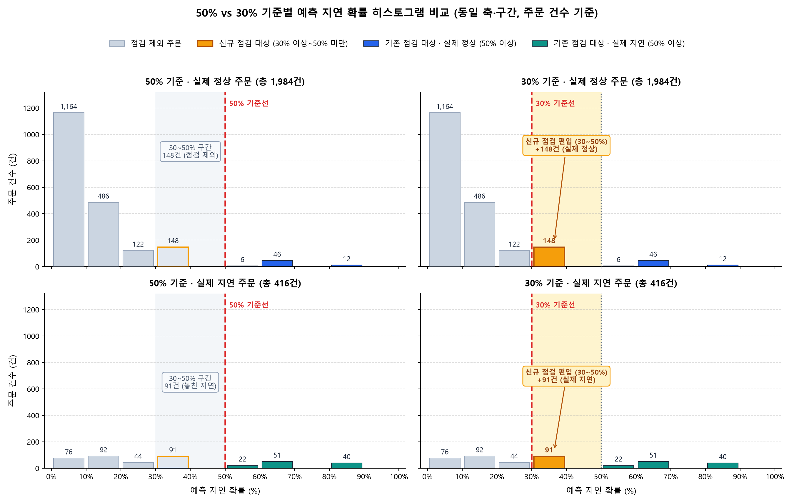

---

## 2단계. 10회차 기준 전환 및 50% 임계값 혼동행렬

- **사용 자료:** `10회/data/delivery_predictions_09.csv` (평가 2,400건: 실제 정상 1,984건 · 실제 지연 416건)
- **기준 임계값:** `50%` (`의사결정나무_지연확률 >= 0.50`)

| 모델 예측 \ 실제 결과 | 실제 정상 (`1,984건`) | 실제 지연 (`416건`) | 합계 |
|---|---:|---:|---:|
| **정상 예측 · 점검 제외** (`< 50%`) | **1,918건** (`79.92%`, TN) | **313건** (`13.04%`, FN) | 2,231건 |
| **지연 예측 · 점검 대상** (`≥ 50%`) | **66건** (`2.75%`, FP) | **103건** (`4.29%`, TP) | 169건 |

- **네 칸의 업무상 의미:**
  1. **TN (`1,918건`):** 정상 주문을 정상 출고해 운영 효율을 유지함.
  2. **FN (`313건`):** 지연 주문을 놓쳐 사전 조치 없이 납기 지연·고객 클레임 위험으로 이어짐.
  3. **FP (`66건`):** 정상 주문을 점검해 인력·시간이 추가 소요되는 과탐 비용이 발생함.
  4. **TP (`103건`):** 지연 위험 주문을 사전에 포착해 재고 배정·운송 조정 등 선제 대응이 가능함.
- **시각화:** 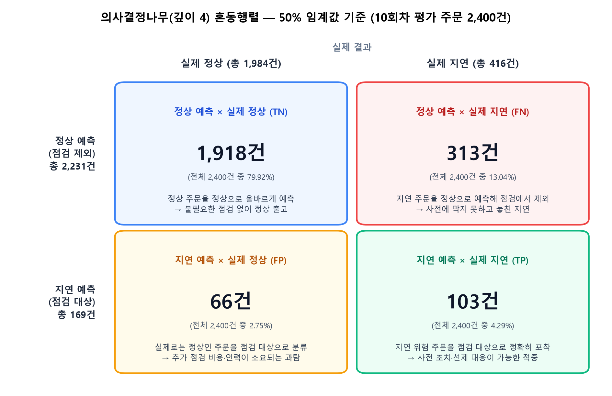

---

## 3단계. 50% 기준 정확도 · 정밀도 · 재현율 비교 및 해석

| 지표 | 계산 (분자 ÷ 분모) | 50% 기준 | (참고) 30% 기준 | 업무상 의미 |
|---|---|---:|---:|---|
| **정확도 (Accuracy)** | `(1,918 + 103) ÷ 2,400` | **84.21%** | 82.33% | 전체 주문 중 맞힌 비율 (정상 비중이 높아 착시 주의) |
| **정밀도 (Precision)** | `103 ÷ 169` | **60.95%** | 49.04% | 점검 대상 중 실제 지연 비율 (점검 효율·타율) |
| **재현율 (Recall)** | `103 ÷ 416` | **24.76%** | 49.04% | 실제 지연 중 미리 찾아낸 비율 (리스크 커버리지) |

- **시각화:** 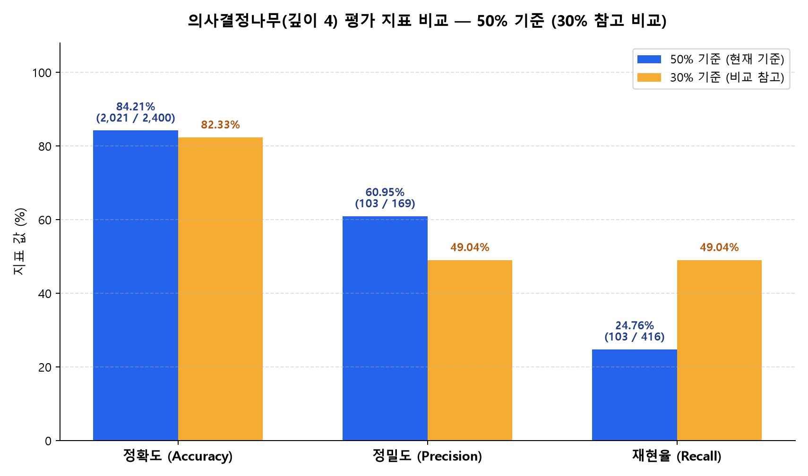

---

## 4단계. 의사결정나무 깊이 4 vs 깊이 6 구조 비교 및 전처리·모델 저장

- **설정:** 입력 15개(원-핫 인코딩 후 `36개` 변수), `1~6월 7,200건` 학습 데이터에만 전처리 fit, `min_samples_leaf=50`, `random_state=20261123` 유지, `max_depth`만 `4 → 6` 변경

| 모델 | 설정 `max_depth` | `min_samples_leaf` | 실제 깊이 | 실제 잎 수 | 이론상 최대 잎 수 (`2^깊이`) |
|---|---:|---:|---:|---:|---:|
| **의사결정나무 · 깊이 4 (기존)** | 4 | 50 | **4** | **16개** | 16개 |
| **의사결정나무 · 깊이 6 (신규)** | 6 | 50 | **6** | **47개** | 64개 |

- **저장 파일:** `results/delivery_tree_depth6_10.joblib`, `results/preprocessed_train_10.csv`, `results/preprocessed_eval_10.csv`
- **시각화:** 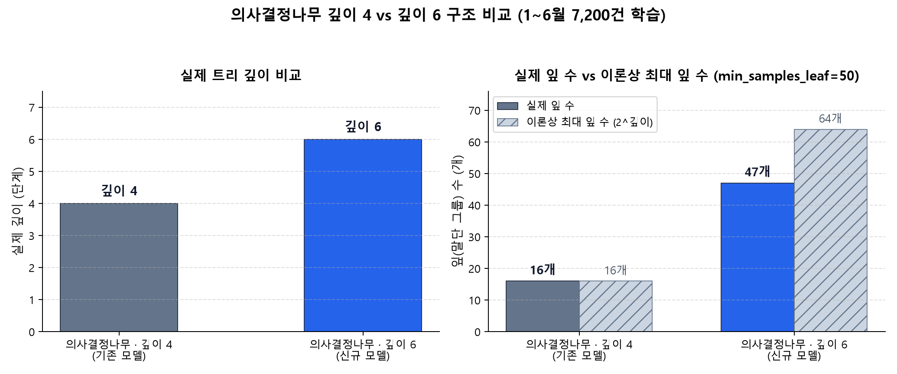

---

## 5단계. 의사결정나무 깊이 4 vs 깊이 6 학습·평가 성능 비교

| 모델 | 구분 | 정확도 | 정밀도 | 재현율 | F1 Score | 점검 대상 | 찾아낸 지연 (TP) | 과탐 정상 (FP) | 놓친 지연 (FN) |
|---|---|---:|---:|---:|---:|---:|---:|---:|---:|
| **깊이 4** | 학습 (`7,200건`) | 85.11% | 67.70% | 26.31% | 37.89% | 483건 | 327건 | 156건 | 916건 |
| **깊이 6** | 학습 (`7,200건`) | 85.54% | 66.72% | 32.42% | 43.64% | 604건 | 403건 | 201건 | 840건 |
| **깊이 4** | 평가 (`2,400건`) | 84.21% | 60.95% | 24.76% | 35.21% | 169건 | 103건 | 66건 | 313건 |
| **깊이 6** | 평가 (`2,400건`) | **84.71%** | **61.40%** | **31.73%** | **41.84%** | 215건 | 132건 | 83건 | 284건 |

- **핵심 해석:** 깊이를 `4 → 6`으로 늘리자 정밀도는 유지(`60.95% → 61.40%`)되면서 평가 재현율(`24.76% → 31.73%`)과 F1(`35.21% → 41.84%`)이 상승했고, `min_samples_leaf=50` 덕분에 과적합 없이 새 주문에서도 성능이 개선됨.
- **시각화:** 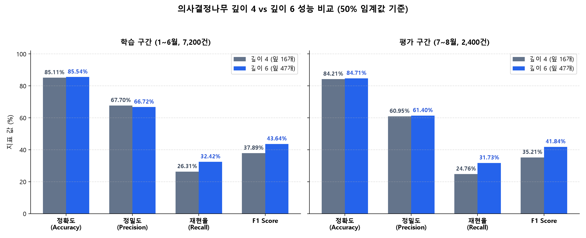

---

## 6단계. 랜덤포레스트(`None`) 및 가중치 적용 랜덤포레스트(`balanced`) 학습

- **공통 설정:** `n_estimators=200`, `max_depth=6`, `min_samples_leaf=50`, `max_features='sqrt'`, `bootstrap=True`, `random_state=20261123`
- **저장 파일:** `results/delivery_forest_10.joblib` (`class_weight=None`), `results/delivery_forest_balanced_10.joblib` (`class_weight='balanced'`), `results/delivery_predictions_10.csv` (총 4개 모델 예측·확률 저장)
- **시각화:** 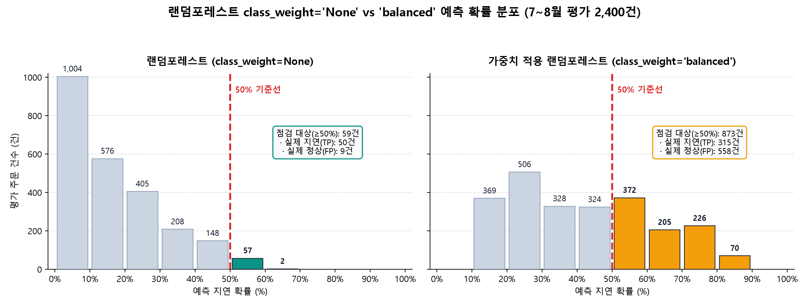

---

## 7단계. 네 개 모델 최종 성능 비교 및 업무 상황별 추천 (평가 2,400건 · 50% 기준)

| 모델명 | 정확도 | 정밀도 | 재현율 | F1 Score | 점검 대상 | 찾아낸 지연 (TP) | 과탐 정상 (FP) | 놓친 지연 (FN) |
|---|---:|---:|---:|---:|---:|---:|---:|---:|
| **의사결정나무 · 깊이 4** | 84.21% | 60.95% | 24.76% | 35.21% | 169건 | 103건 | 66건 | 313건 |
| **의사결정나무 · 깊이 6** | **84.71%** | 61.40% | 31.73% | 41.84% | 215건 | 132건 | 83건 | 284건 |
| **랜덤포레스트 (None)** | 84.38% | **84.75%** | 12.02% | 21.05% | **59건** | 50건 | **9건** | 366건 |
| **가중치 적용 랜덤포레스트 (balanced)** | 72.54% | 36.08% | **75.72%** | **48.88%** | 873건 | **315건** | 558건 | **101건** |

- **시각화:**
  - 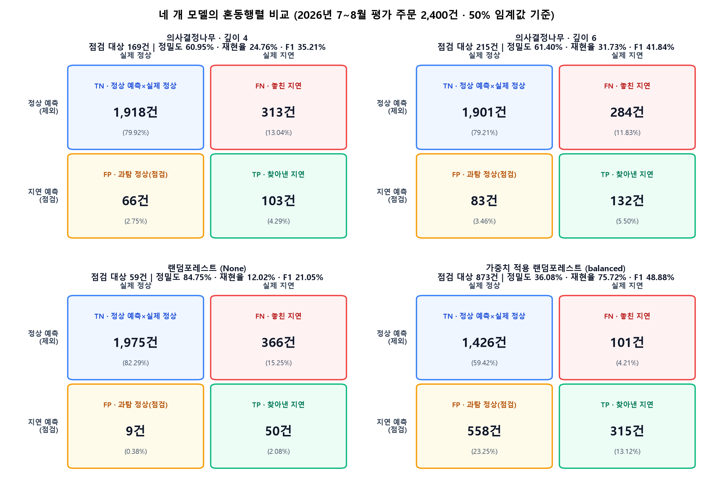
  - 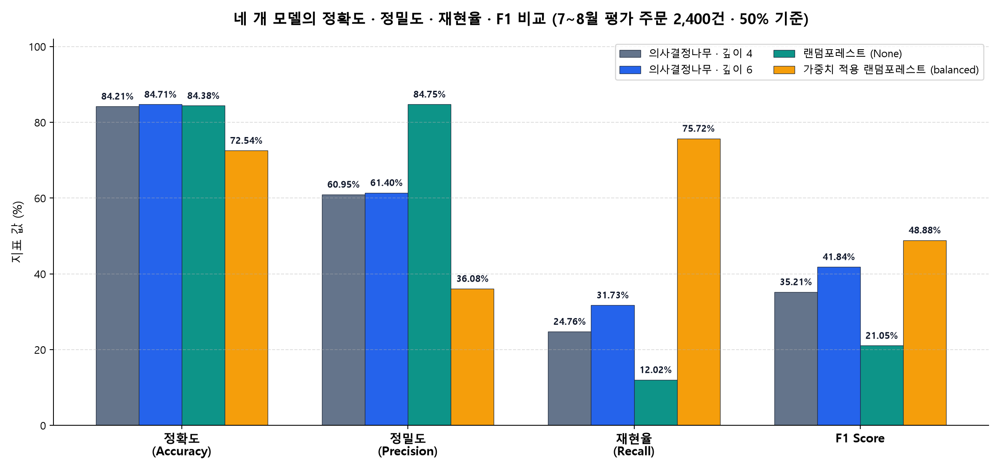

### 업무 상황별 추천 모델
1. **점검 인력이 부족할 때 → `랜덤포레스트 (None)`** *(여력이 조금 더 있다면 `의사결정나무 · 깊이 6`)*
   - 점검 대상이 **`59건`**으로 가장 적고, 점검 대상 중 **`84.75%`(`50/59건`)가 실제 지연**이어서 인력 낭비(`FP 9건`)가 가장 적음.
2. **지연 주문을 놓치는 부담이 클 때 → `가중치 적용 랜덤포레스트 (balanced)`**
   - 실제 지연 `416건` 중 **`315건`(`재현율 75.72%`)**을 포착해 놓친 지연을 **`101건`**까지 줄이고 **`F1 48.88%`**로 최고점을 기록함 (단, `873건`의 점검 물량을 소화할 인력 필요).

---

## 8단계. 대시보드 HTML 제작 · GitHub 업로드 및 Slack 제출 정리

- **대시보드 파일:** `results/delivery_model_review.html` (4모델 비교표·그래프·혼동행렬, 임계값/단계별 탭, 모델별 우선 점검 목록 `876건` 필터, 운영 검토 의견 포함, 오프라인 단독 실행 가능)
- **GitHub 저장소:** `https://github.com/ohyacintho/project2-dashboard` (`main` 브랜치, `dashboard/delivery-model-10/delivery_model_review.html`)
- **제출용 캡처 이미지:**
  - 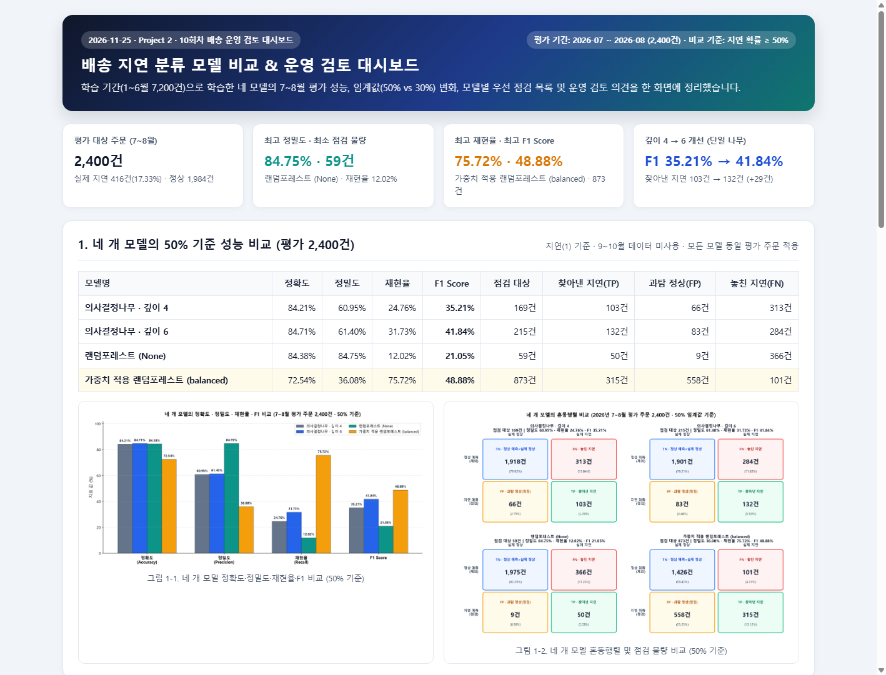
  - 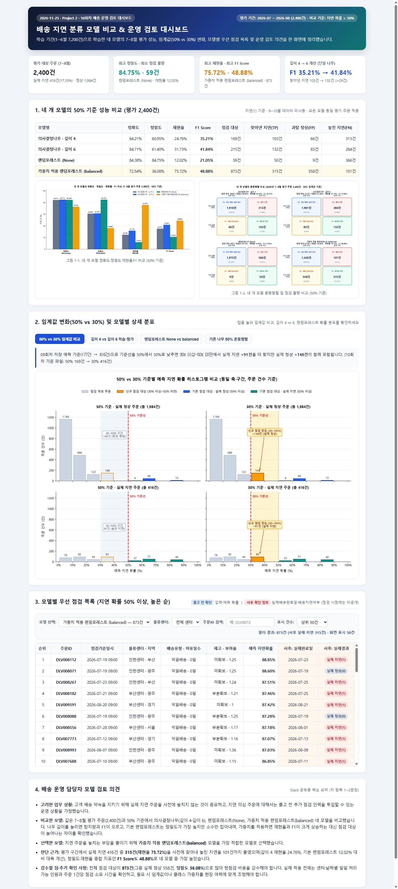

---

## 9단계. [추가실습 1] 특정 센터에 적합한 모델 검토 (`인천센터`)

- **시작 자료:** `results/delivery_predictions_10.csv`, `results/model_comparison_10.csv` (모델 재학습 없이 저장된 예측 사용, 50% 기준)

### 9-1. 센터별 평가 주문 · 실제 지연 · 지연률 현황 (`results/center_delay_summary_extra.csv`)

| 물류센터 | 평가 주문 수 | 실제 지연 수 | 실제 지연률 | 비고 |
|---|---:|---:|---:|---|
| 대전센터 | 826건 | 113건 | 13.68% | 주문 수 최다, 지연률 최저 |
| 부산센터 | 788건 | 144건 | 18.27% | 전체 평균(17.33%) 상회 |
| **인천센터** | **786건** | **159건** | **20.23%** | **지연 건수·지연률 모두 1위 (관심 센터 선정)** |

- 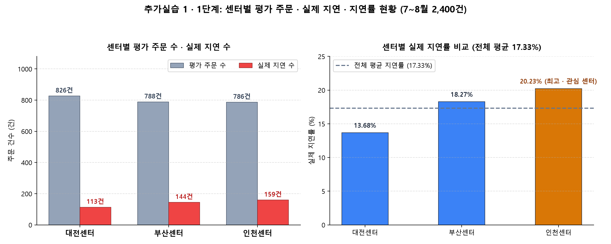

### 9-2. 인천센터 네 개 모델 비교 (`results/center_model_comparison_extra.csv`)

| 모델명 | 정확도 | 정밀도 (전체) | 재현율 (전체) | F1 Score (전체) | 점검 대상 | 찾아낸 지연(TP) | 과탐 정상(FP) | 놓친 지연(FN) |
|---|---:|---:|---:|---:|---:|---:|---:|---:|
| 의사결정나무 · 깊이 4 | 82.32% | 65.15% (`60.95%`) | 27.04% (`24.76%`) | 38.22% (`35.21%`) | 66건 | 43건 | 23건 | 116건 |
| 의사결정나무 · 깊이 6 | 82.95% | 64.71% (`61.40%`) | 34.59% (`31.73%`) | 45.08% (`41.84%`) | 85건 | 55건 | 30건 | 104건 |
| 랜덤포레스트 (None) | 81.81% | **80.77%** (`84.75%`) | 13.21% (`12.02%`) | 22.70% (`21.05%`) | **26건** | 21건 | **5건** | 138건 |
| **가중치 적용 RF (balanced)** | 74.68% | 43.29% (`36.08%`) | **81.13%** (`75.72%`) | **56.46%** (`48.88%`) | 298건 | **129건** | 169건 | **30건** |

- 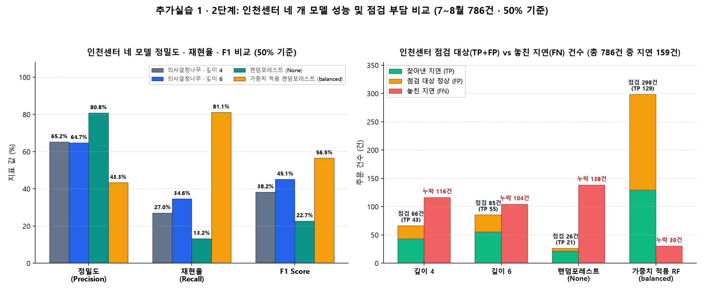

### 9-3. 인천센터 의견 정리 및 추가실습 1 HTML · 캡처 이미지
- **검토 의견:** 인천센터는 지연률(`20.23%`)이 가장 높아 지연 누락 부담이 크므로, 실제 지연 `159건` 중 **`129건`(`재현율 81.13%`)**을 찾아내고 **`F1 56.46%`**를 기록한 **`가중치 적용 랜덤포레스트 (balanced)`**를 우선 고려합니다(전체 평균 대비 정밀도 `+7.21%p`, 재현율 `+5.41%p`, F1 `+7.58%p`). 다만 점검 대상 **`298건`**(정상 과탐 `169건`, 정밀도 `43.29%`)을 감수해야 하며, 현장 인력이 제한적일 때는 `85건` 점검에 정밀도 `64.71%`·TP `55건`인 **`의사결정나무 · 깊이 6`**을 대안으로 고려할 수 있습니다.
- **추가실습 1 HTML:** `results/delivery_center_review_extra.html`
- **추가실습 1 캡처 이미지:**
  - 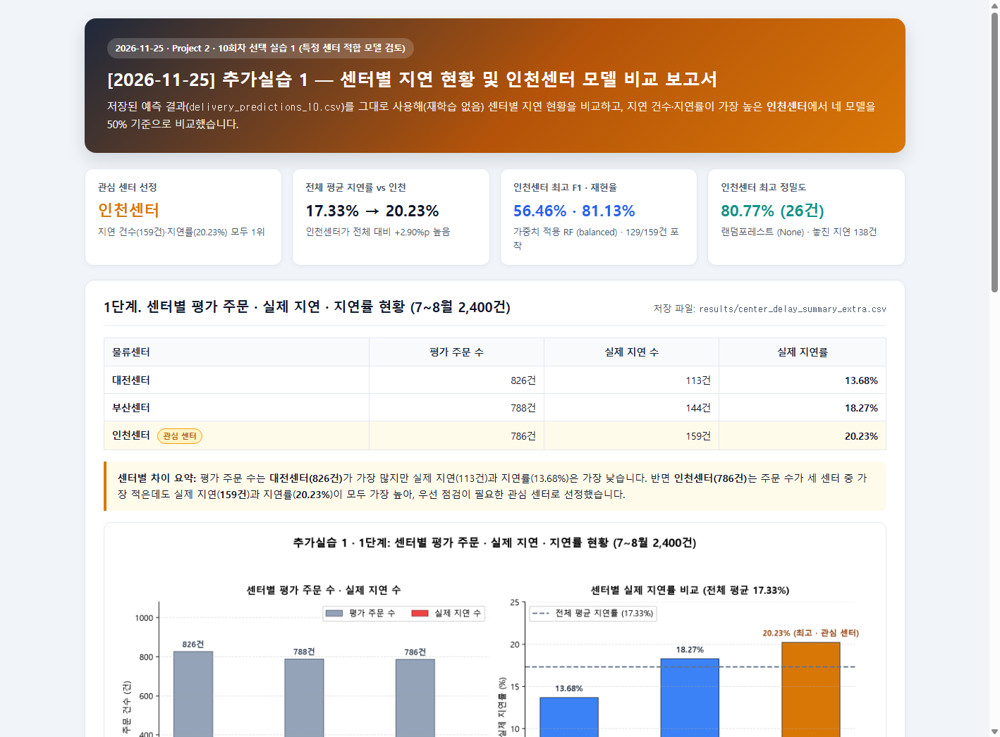
  - 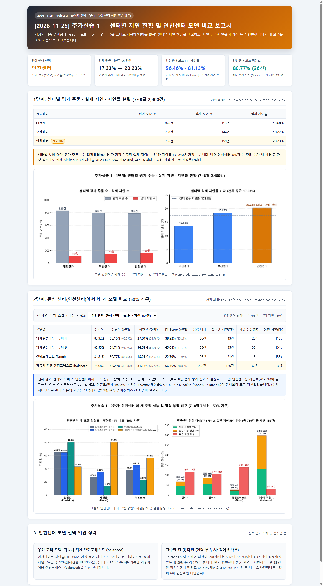

